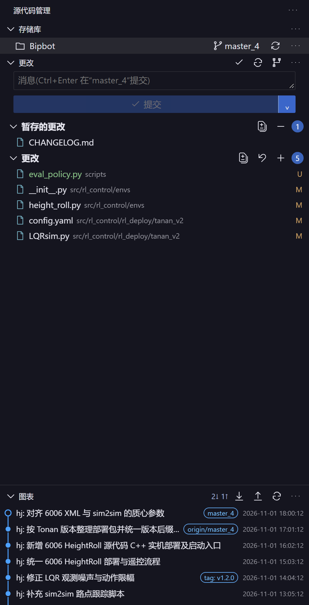
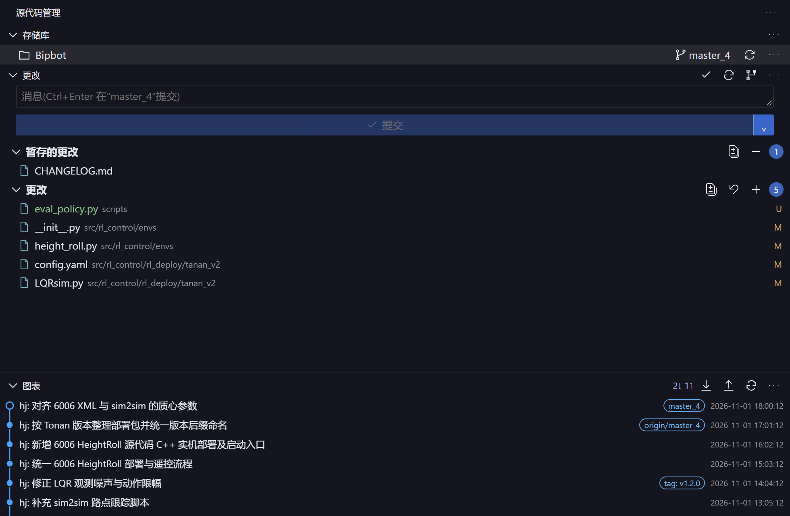
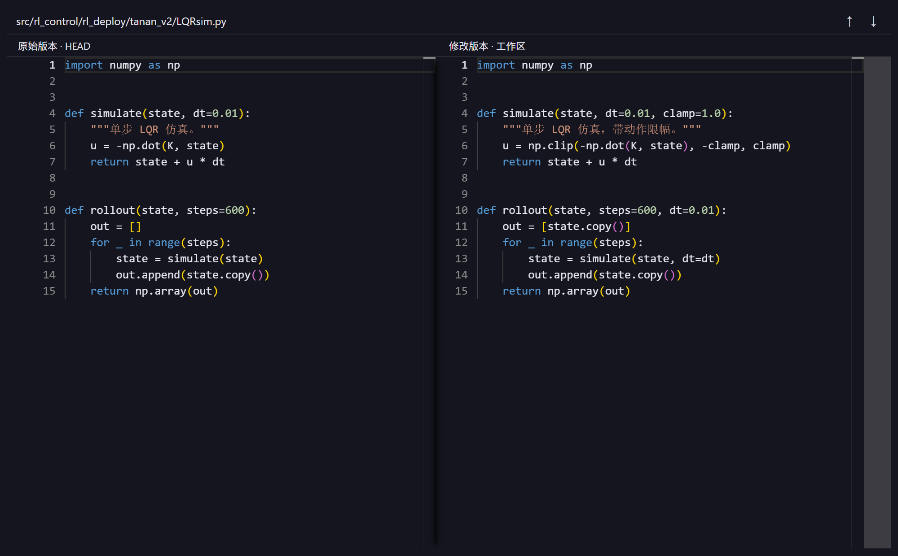

# DSH SCM

English | [简体中文](README.md)

A **native source-control plugin for [DeepSeek Harness](https://github.com/deepseek-ai)** with a VS Code-style Git panel in the right sidebar, Monaco side-by-side diffs, and a built-in commit graph. Everything ships inside the plugin — no external fonts, CDN, or background service.

The plugin loads as a DSH client plugin (`web` platform, injected into the right-sidebar slot). The host half exposes a single route surface, `POST /dsh-scm/<operation>`, over Git. The Git backend is derived from the MIT-licensed [dsh-source-control](https://github.com/jackchen13755/dsh-source-control); the UI, diff views and graph are implemented here. Upstream copyright and license notices are preserved in [LICENSE](LICENSE) and [THIRD_PARTY_NOTICES.md](THIRD_PARTY_NOTICES.md).

## Screenshots

<table>
<tr>
<td valign="top" width="300">
<br>
<sub>Source control panel</sub>
</td>
<td valign="top">
<br>
<sub>Commit graph</sub>
<br><br>
<br>
<sub>Diff view</sub>
</td>
</tr>
</table>

<sub>Rendered from the repository's preview tooling against the real plugin panel (`src/client/panel.ts`, `src/client/diffEditor.ts`, with Monaco served from local plugin assets) plus sample data. The UI matches 0.3.0.</sub>

## Features

**Repositories and workspaces**

- Discovers repositories from the current session workspace; supports multiple repos and Git worktrees inside one workspace.
- Repository menu: sort order (discovery / path / name) and section visibility toggles, persisted in browser `localStorage`.
- `init` an uninitialized directory; clone targets are confined to the current workspace.

**Changes view**

- Three groups — Changes, Staged Changes, Merge Changes — in tree or list layout, sorted by path / name / status.
- Hover actions on a file row: `+` stage, `−` unstage, revert arrow to discard unstaged changes; the context menu offers the same actions plus "Open File".
- Changes header menu: view changes (multi-file diff), stage all, discard all (confirmation required, staged content preserved).
- Staged header menu: view staged changes, unstage all.
- Opening a file uses the session's `dsh-resource` file address, so Windows, UNC, Unicode and special-character paths work.

**Commits**

- Commit box with `Ctrl/Cmd+Enter`; when nothing is staged the plugin asks whether to stage everything first.
- Commit dropdown: commit, amend last commit (rewrites history, double confirmation), commit and push, commit and sync.
- Sync and pull are fast-forward only — no automatic merge commits.

**Diffs**

- Monaco side-by-side editor; scripts, workers, CSS and the icon font are all bundled locally.
- Line numbers, synchronized scrolling, word-level highlighting, previous/next change navigation; `F5` refreshes, `Esc` closes.
- Multi-file diff creates and disposes editors by visibility and supports collapse all / expand all.
- File preview capped at 2 MB; binary files are reported instead of rendered; renames keep the old path.

**Branches, remotes and merges**

- Switch, create and delete branches; list, add and remove remotes.
- Pull (fast-forward only), push, publish branch (sets upstream), merge.
- `undo-commit` reverts the last commit; a briefly locked Git index is retried, a persistent lock is reported and never force-removed.

**Stash, tags and worktrees**

- Stash: list, save, apply, pop, drop.
- Tags: list, create, delete, push tags.
- Worktrees: list, add, remove, prune.

**Graph**

- Drawn from real commits and their parent relationships, including multi-branch and merge lanes, filterable by branch.
- Loads up to 200 commits; clicking a commit expands its file list inline, and clicking a file opens the diff between that commit and its first parent (root commits diff against an empty file).
- The splitter is draggable to resize the graph.

**Theme and performance**

- Transparent panel background; text, inputs, hover, selection and borders read DSH theme variables. Monaco is transparent too and follows theme changes.
- Automatic state polling every 5 seconds, only while the page is visible and the panel is shown; the graph refreshes on explicit refresh or after a Git operation.

## Installation

### Requirements

- DeepSeek Harness (desktop or web), plugin requires `dsh >= 0.1.5-rc.1`.
- Node.js 22+ and npm only when installing from source or rebuilding.
- Git 2.20+ on `PATH`.
- Push and pull use your existing Git credentials (HTTPS or SSH); the plugin starts no extra auth service.

### Option 1 — from source (recommended)

```powershell
git clone https://github.com/2757657887/dsh-scm.git
cd dsh-scm
npm install --ignore-scripts
npm run build
dsh plugin --profile desktop add <absolute-path-to-repo> --offline
```

**Restart DSH** afterwards. The plugin registers a right-sidebar tab: right sidebar → new tab → Source Control.

`npm run build` compiles the host TypeScript, bundles the browser modules, and copies Monaco and codicon assets into `lib/assets`. A fresh clone has no loadable client code until it is built.

### Option 2 — from npm (published releases)

```powershell
dsh plugin add dsh-scm
```

### Verify the install

1. Restart DSH, open the right sidebar in any project, and look for the new "Source Control" tab.
2. The panel lists repositories and branches from the current workspace, and the Changes group shows real files.
3. The host route can be checked directly (useful for diagnosis):

```powershell
curl -s -X POST http://127.0.0.1:<DSH-port>/dsh-scm/context `
  -H "content-type: application/json" `
  --data '{"sessionId":"session-<session-id>"}'
```

A `{"ok":true,"value":{"workspace":...,"repos":[...]}}` response means the host half loaded. The `sessionId` must be the full id including the `session-` prefix.

### Uninstall

```powershell
dsh plugin --profile desktop remove dsh-scm
```

## Usage

After restarting DSH, open the right sidebar in a project session → new tab → Source Control. The panel resolves repositories from the current session workspace; every Git operation runs in the host process and only touches repositories inside that workspace.

Shortcuts: `Ctrl/Cmd+Enter` commit, `F5` refresh, `Esc` close the diff view, drag the graph splitter to resize.

## Known limits

This version reproduces the main layout and the common Git workflows; it is not a full port of Microsoft's VS Code source control. Diffs use a local read-only Monaco editor and do not include line/hunk staging, GitLens capabilities, a full merge editor, or every VS Code command and setting. Merge conflicts can be inspected and staged but must be resolved in a normal file editor. The graph loads at most 200 commits.

The panel is transparent and reads DSH theme variables; SVG icons are inlined to avoid external font or VS Code service failures. Git output logging covers only operations performed by this plugin; other VS Code or third-party extension commands are out of scope.

## Development

```powershell
npm install --ignore-scripts
npm run typecheck   # type-check both host and client tsconfigs
npm test            # builds the host, then runs node --test (34 tests)
npm run build       # compile host + bundle client + copy Monaco assets
```

Layout:

| Path | Contents |
| --- | --- |
| `src/host` | Host side: Git execution, repository resolution, routes and request guards |
| `src/client` | Browser side: panel, diff editor, graph, navigation, theme |
| `lib` | Build output (what the plugin actually loads), committed to the repo |
| `cordis.patch.yml` | DSH configuration patch layer shipped with the package |
| `scripts` | Bundling, Monaco asset copying, smoke scripts |
| `test` | Integration, graph and file-navigation tests |
| `preview` | Standalone UI preview tool that runs without DSH |

After editing sources run `npm run build` and restart DSH. Host changes (`src/host`) require a restart; client changes are picked up by DSH's client HMR after the build. No background service or startup entry is installed.

## Changelog

### 0.3.0

- Split the header into section-visibility, repository-actions, changes-actions and commit menus, matching the reference screenshots; section visibility, tree view and sorting are configurable.
- The repository menu covers common commit, change, pull/push, branch, remote, stash, tag and worktree operations; destructive actions require confirmation. Clone targets a new directory inside the current workspace.
- The commit dropdown supports commit, amend last commit, commit and push, and commit and sync; sync pulls fast-forward only.
- Added a dedicated DSH Git graph tab with per-branch filtering — a plugin-built graph, not the VS Code Git Graph extension.
- Git output logging covers only this plugin's operations; the graph shows at most 200 commits and other VS Code or third-party commands are out of scope.

Verification: 34 tests pass; build and type check pass, and the client bundle was repacked into 9 modules. After restarting DSH the host half was confirmed live: the newly added `head-message`, `tag-list`, `stash-list` and `worktree-list` operations dispatch, and `context` discovers 3 repositories in the workspace. A read-only walkthrough of `status`, `log`, `head-message`, `branches`, `tag-list`, `stash-list` and `worktree-list` against a real repository returned real data (`main` tracking `origin/main`, 1 commit, 1 tag, 1 stash, 2 worktrees) without modifying any file. A per-item visual comparison against the reference screenshots was not part of this verification.

### 0.2.2

Matches the VS Code Git extension's git.viewChanges / git.cleanAll / git.stageAll / git.openFile commands:

- Changes header: view changes (multi-file side-by-side diff), discard all, stage all.
- Staged header: view staged changes, unstage all.
- File row hover: open file (native DSH file tab), discard changes, stage/unstage. The context menu also offers open file.
- Native file navigation uses the session's dsh-resource address and supports Windows, UNC, Unicode and special-character paths.
- Multi-file diff creates and disposes Monaco editors by visibility, with collapse all / expand all, avoiding a burst of editors.
- Discard-all requires confirmation and preserves staged content; switching workspace during the confirmation aborts the operation.

Verification: 23 tests pass; build and type check pass. In an isolated DSH the 89-file multi-diff view of SuperBipbot was opened, collapse-all verified, MUJOCO_LOG.TXT opened as a plain file, and a test discard confirmation cancelled — no user project files were modified.

### 0.2.1

- The commit file list now expands inline right after its commit row, sharing the scroll area; switching revisions collapses the previous list, and clicking the same revision again collapses it.
- The expanded file area keeps the graph lanes and is no longer pinned to the bottom of the graph, and no longer grows the graph.
- Removed the fixed purple panel background in favour of a transparent one; text, inputs, hover, selection and borders read DSH theme variables.
- The Monaco editor uses a transparent background; text and line-number colours follow DSH, and theme listeners are released on change.
- Verification: build and type check pass, 18 automated tests pass; in an isolated DSH the revision switching, inline placement and diff background were checked.

### 0.2.0

- Switched to the Monaco side-by-side diff editor; all scripts, workers, CSS and the icon font are served by the plugin itself.
- Selecting a commit in the graph shows its file list inline; diffs open in a separate DSH tab while the source control panel stays open.
- Staging retries when the Git index is briefly locked; a persistent lock produces an explicit message and is never force-removed.
- Workspace diffs compare index against working tree, staged diffs compare HEAD against index, and history diffs compare the first parent against that commit.
- File preview capped at 2 MB; binary files reported; renames keep the old path; models and workers are disposed when the editor unmounts.
- 18 tests pass, covering the file-version and lock handling above.

### 0.1.0

First release: VS Code-style source control panel in the right sidebar, repository and branch listing, stage/commit/discard, commit history and diff viewing.

## License

MIT — see [LICENSE](LICENSE). Licenses and copyright notices for third-party components and the ported backend are in [THIRD_PARTY_NOTICES.md](THIRD_PARTY_NOTICES.md).
