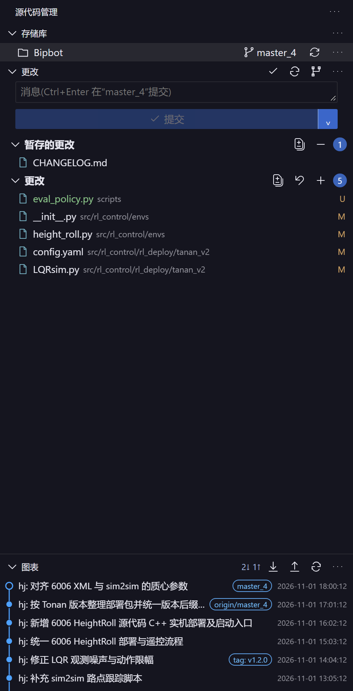
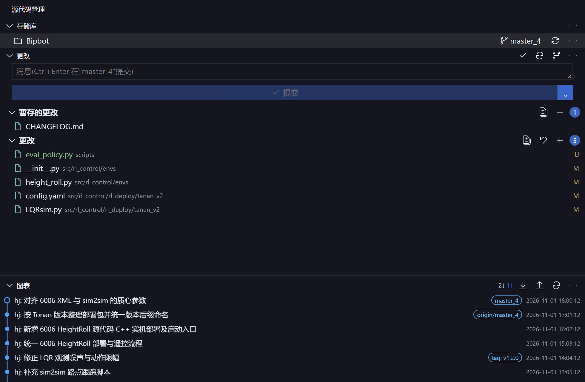
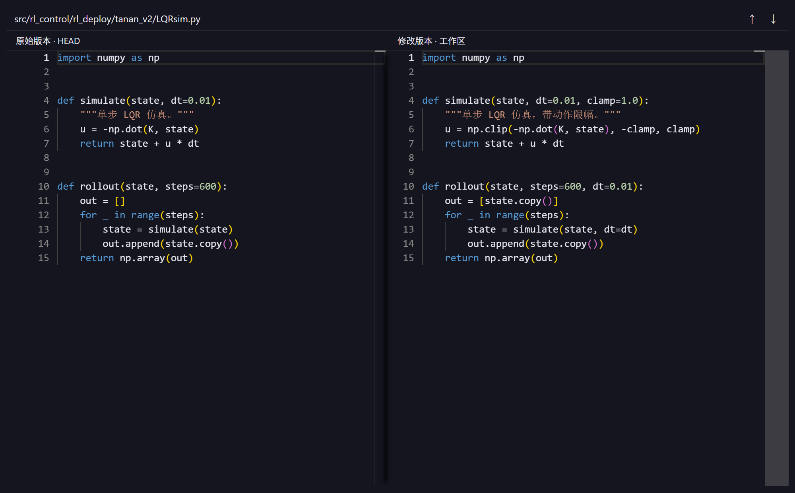

# DSH SCM

[English](README.en.md) | 简体中文

VS Code 风格的 **DSH 原生源代码管理插件**：右侧栏 Git 面板、Monaco 左右差异视图、原生提交图表，全部由插件本地提供，不依赖外部字体、CDN 或后台服务。

插件以 DSH 客户端插件形式加载（`web` 平台，注入右侧栏槽位），宿主侧以单一路由面 `POST /dsh-scm/<operation>` 暴露 Git 操作。Git 后端改造自 MIT 许可的 [dsh-source-control](https://github.com/jackchen13755/dsh-source-control)，界面、差异视图与图表为本项目实现；原作者的授权与版权声明保留在 [LICENSE](LICENSE) 与 [THIRD_PARTY_NOTICES.md](THIRD_PARTY_NOTICES.md)。

## 效果图

<table>
<tr>
<td valign="top" width="300">
<br>
<sub>源代码管理面板</sub>
</td>
<td valign="top">
<br>
<sub>提交图表</sub>
<br><br>
<br>
<sub>差异视图</sub>
</td>
</tr>
</table>

<sub>截图由仓库内的预览工具渲染真实插件面板（`src/client/panel.ts`、`src/client/diffEditor.ts`，Monaco 资源同为插件本地文件）并注入示例数据得到，与 0.3.0 界面一致。</sub>

## 功能

**仓库与工作区**

- 按当前会话工作区自动发现仓库，支持同一工作区内的多个仓库与 Git 工作树。
- 仓库菜单提供排序（发现顺序 / 路径 / 名称）、区域显示开关，设置持久化在浏览器 `localStorage`。
- 未初始化的目录可直接 `init`；克隆目标限制在当前工作区内。

**更改视图**

- 「更改」「暂存的更改」「合并更改」三个分组，支持树形 / 列表两种布局，以及按路径 / 名称 / 状态排序。
- 文件行悬停图标：`+` 暂存、`−` 取消暂存、回退箭头放弃未暂存更改；右键菜单提供同样的操作与「打开文件」。
- 「更改」标题菜单：打开更改（多文件差异）、暂存所有更改、放弃所有更改（需确认，保留已暂存内容）。
- 「暂存的更改」标题菜单：打开暂存的更改、取消暂存所有更改。
- 打开文件使用当前会话的 `dsh-resource` 文件地址，支持 Windows、UNC、Unicode 与特殊字符路径。

**提交**

- 提交框支持 `Ctrl/Cmd+Enter` 提交；没有已暂存内容时先询问是否暂存所有更改。
- 提交下拉菜单：提交、修改上次提交（改写历史，二次确认）、提交并推送、提交并同步。
- 同步与拉取默认只允许快进，不会自动产生合并提交。

**差异视图**

- Monaco 左右差异编辑器，脚本、Worker、CSS 与图标字体均由插件本地打包。
- 行号、同步滚动、词级高亮、上一个 / 下一个更改导航；`F5` 刷新，`Esc` 返回。
- 多文件差异按可见范围创建与释放编辑器，支持全部折叠 / 展开。
- 文件预览上限 2 MB；二进制文件显示说明；重命名保留旧路径。

**分支、远程与合并**

- 分支切换、创建、删除；远程列表、添加与删除远程。
- 拉取（仅快进）、推送、发布分支（设置 upstream）、合并。
- `undo-commit` 撤销最近一次提交；Git 索引短暂被锁时等待重试，持续锁定给出明确提示且不会自动删锁。

**存储、标记与工作树**

- Stash：列表、保存、应用、弹出、删除。
- Tag：列表、创建、删除、推送标记。
- Worktree：列表、添加、删除、清理。

**图表**

- 基于真实提交与其父节点关系绘制，显示多分支与合并连线，可按分支过滤。
- 最多加载 200 条提交；点击提交在该行内联展开文件清单，点击文件打开「该提交与第一父提交」的差异，根提交对比空文件。
- 可拖动分隔条调整图表高度。

**主题与性能**

- 主面板透明背景，文字、输入框、悬停、选中态与边框读取 DSH 主题变量；Monaco 背景透明并跟随主题切换。
- 自动状态刷新每 5 秒一次，仅在页面可见且面板显示时运行；图表在显式刷新或 Git 操作后更新。

## 安装

### 前置条件

- DeepSeek Harness（桌面端或 Web 版），插件要求 `dsh >= 0.1.5-rc.1`。
- 安装插件本身不需要构建；仅从源码安装或修改源码时需要 Node.js 22+ 与 npm。
- Git 2.20+ 在 `PATH` 中。
- 推送 / 拉取使用 Git 已配置好的凭据（HTTPS 或 SSH），插件不启动额外的认证服务。

### 方式一：从源码安装（推荐）

```powershell
git clone https://github.com/2757657887/dsh-scm.git
cd dsh-scm
npm install --ignore-scripts
npm run build
dsh plugin --profile desktop add <仓库绝对路径> --offline
```

安装后**重启 DSH**。插件注册为右侧栏的一个标签页：右侧栏 → 新标签页 → 源代码管理。

`npm run build` 会编译宿主侧 TypeScript、打包浏览器端模块，并把 Monaco 与 codicon 资源复制到 `lib/assets`，因此克隆后不构建就没有可加载的客户端代码。

### 方式二：从 npm 安装（已发布版本）

```powershell
dsh plugin add dsh-scm
```

### 安装后确认

1. 重启 DSH，在任意项目中打开右侧栏，新增「源代码管理」标签页。
2. 面板能列出当前工作区内的仓库与分支；`更改` 分组显示真实文件。
3. 宿主路由可用（可选，用于排查）：

```powershell
curl -s -X POST http://127.0.0.1:<DSH 端口>/dsh-scm/context `
  -H "content-type: application/json" `
  --data '{"sessionId":"session-<会话 id>"}'
```

返回 `{"ok":true,"value":{"workspace":...,"repos":[...]}}` 即宿主侧加载成功。`sessionId` 必须是带 `session-` 前缀的完整 id。

### 卸载

```powershell
dsh plugin --profile desktop remove dsh-scm
```

## 使用

重启 DSH 后，在项目会话中打开右侧栏 → 新标签页 → 源代码管理。面板按当前会话的工作区解析仓库，所有 Git 操作在宿主进程内执行，只作用于当前工作区内的仓库。

常用快捷键：`Ctrl/Cmd+Enter` 提交、`F5` 刷新状态、`Esc` 关闭差异视图、拖动图表分隔条调整高度。

## 已知边界

本版本复现主要布局和常用 Git 工作流，并非微软 VS Code 源代码管理器的完整移植。差异查看使用本地 Monaco 双栏编辑器，目前为只读，不包含逐行 / 区块暂存、GitLens 扩展能力、完整合并编辑器、所有 VS Code 命令和设置项。合并冲突可查看并暂存，但需要在原文件编辑器里完成修改。图表最多加载 200 个提交。

主面板使用透明背景并读取 DSH 主题变量，SVG 图标直接内联，避免外部字体或 VS Code 服务故障。Git 输出日志仅记录本插件执行的操作，其他 VS Code 或第三方扩展命令不在本版本范围内。

## 开发

```powershell
npm install --ignore-scripts
npm run typecheck   # 宿主侧 + 客户端两套 tsconfig 的类型检查
npm test            # 构建宿主侧后运行 node --test（34 项）
npm run build       # 编译宿主 + 打包客户端 + 复制 Monaco 资源
```

目录结构：

| 路径 | 内容 |
| --- | --- |
| `src/host` | 宿主侧：Git 执行、仓库解析、路由与请求防护 |
| `src/client` | 浏览器端：面板、差异编辑器、图表、导航与主题 |
| `lib` | 构建产物（插件实际加载的文件），随仓库提交 |
| `cordis.patch.yml` | 插件包自带的 DSH 配置补丁层 |
| `scripts` | 打包、Monaco 资源复制与冒烟脚本 |
| `test` | 集成、图表与文件导航测试 |
| `preview` | 脱离 DSH 的独立界面预览工具 |

修改源码后必须 `npm run build` 并重启 DSH。宿主侧改动（`src/host`）必须重启才能生效；客户端改动在 `npm run build` 后可由 DSH 的客户端 HMR 接收。没有额外后台服务或开机启动项。

## 版本记录

### 0.3.0 更新

- 按截图区分顶部区域显示菜单、仓库操作菜单、更改操作菜单和提交下拉菜单；支持区域显示、文件树和排序设置。
- 仓库菜单提供常用提交、更改、拉取推送、分支、远程、存储、标记和工作树操作；危险操作需要确认。克隆目标为当前工作区内的新目录。
- 提交下拉菜单支持提交、修改上次提交、提交并推送、提交并同步；同步拉取只允许快进。
- 增加独立的 DSH Git 图表标签，可按分支查看提交；这是插件内置图表，并非 VS Code 的 Git Graph 扩展。
- Git 输出仅记录本插件执行的操作；图表最多显示 200 条提交，其他未列出的 VS Code 或第三方扩展命令不在本版本范围内。

验证：34 项测试通过；构建及类型检查通过，客户端包按 9 个模块重新打包。重启 DSH 后确认宿主侧已加载本版本：新增的 `head-message`、`tag-list`、`stash-list`、`worktree-list` 等操作可以正常调度，`context` 能在工作区内发现 3 个仓库。对一个真实仓库走查 `status`、`log`、`head-message`、`branches`、`tag-list`、`stash-list`、`worktree-list`，均返回真实数据（`main` 跟踪 `origin/main`、1 条提交、1 个标记、1 份存储、2 个工作树），只读调用未修改该仓库任何文件。界面外观与参考截图的逐项比对未纳入本次验证。

<details>
<summary>0.2.2 / 0.2.1 / 0.2.0 / 0.1.0</summary>

### 0.2.2 更新

对照 VS Code Git 扩展的 git.viewChanges / git.cleanAll / git.stageAll / git.openFile 命令补齐：

- 「更改」标题：打开更改（多文件左右差异）、放弃所有更改、暂存所有更改。
- 「暂存的更改」标题：打开暂存的更改、取消暂存所有更改。
- 文件行悬停：打开文件（DSH 原生文件标签页）、放弃更改、暂存 / 取消暂存。右键菜单也提供打开文件。
- 原生文件导航使用当前会话的 dsh-resource 文件地址，支持 Windows、UNC、Unicode 和特殊字符路径。
- 多文件差异按可见范围创建和释放 Monaco 编辑器，支持全部折叠 / 展开，避免一次创建大量编辑器。
- 放弃全部需要确认，保留已暂存内容；确认期间切换工作区会拒绝继续执行。

验证：23 项测试通过；构建及类型检查通过。在隔离 DSH 中实际打开 SuperBipbot 的 89 文件多差异视图、验证全部折叠、打开 MUJOCO_LOG.TXT 为普通文件，并取消测试用的放弃确认，没有修改用户项目文件。

### 0.2.1 更新

- 提交文件清单改为紧跟对应提交展开，和版本行共用滚动区域；切换版本时收起旧清单，再次点击同一版本可收起。
- 展开文件区域保留图表连线，不再固定在图表底部，也不再自动增高图表。
- 移除主面板的固定紫色背景，使用透明背景；文字、输入框、悬停、选中态和边框读取 DSH 主题变量。
- Monaco 编辑器背景透明，文字和行号颜色跟随 DSH；监听主题变化并释放主题监听器。
- 验证：构建与类型检查通过，18 项自动测试通过；在隔离 DSH 中实际验证切换提交、内联位置及左右差异的背景。

### 0.2.0 更新

- 改用 Monaco 左右差异编辑器，所有脚本、Worker、CSS 和图标字体均由插件本地提供。
- 图表选中提交后紧跟该提交内联显示文件清单，差异打开到独立 DSH 标签页，保留源代码管理面板。
- 暂存遇到短暂 index.lock 时等待后重试；持续锁显示明确提示，插件不会自动移除锁。
- 工作区差异对比索引与工作区；暂存差异对比 HEAD 与索引；历史差异对比第一父提交与该提交。
- 文件预览上限 2 MB；二进制文件显示说明；重命名保留旧路径；编辑器卸载时释放模型与 Worker 关联。
- 18 项测试通过，涵盖上述文件版本与锁处理。

### 0.1.0

首个版本：VS Code 风格的右侧栏源代码管理面板、仓库与分支列表、暂存 / 提交 / 放弃、提交历史与差异查看。

</details>

## 许可

MIT，见 [LICENSE](LICENSE)。第三方组件与移植来源的许可与版权声明见 [THIRD_PARTY_NOTICES.md](THIRD_PARTY_NOTICES.md)。
